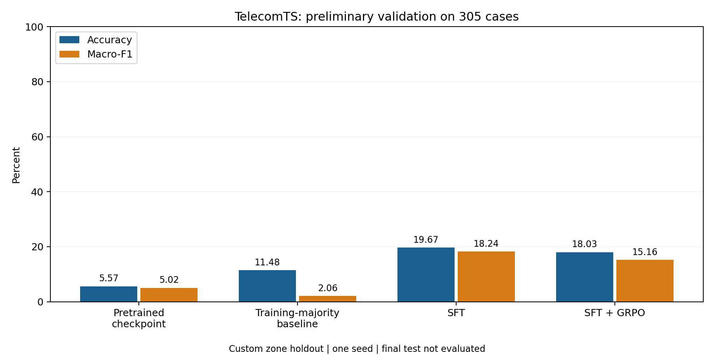

# Telecom LLM results

Preliminary aggregate results for Qwen2.5-1.5B-Instruct on a custom TelecomTS classification task. Research is ongoing. This repository releases measurements only; implementation, training recipes, checkpoints, prompts, data, and research plans are withheld.

Snapshot: **13 November 2026**. All primary models were evaluated on the same **305 validation cases**.

| Model | Correct / 305 | Accuracy | Macro-F1 |
|---|---:|---:|---:|
| Pretrained checkpoint | 17 | 5.57% | 5.02% |
| Training-majority baseline | 35 | 11.48% | 2.06% |
| SFT | 60 | 19.67% | 18.24% |
| SFT + GRPO | 55 | 18.03% | 15.16% |

SFT improved accuracy by **14.10 percentage points** over the pretrained checkpoint and **8.20 points** over the training-majority baseline. Macro-F1 improved by **13.23 points** over the pretrained checkpoint. Absolute accuracy remains modest.

The GRPO continuation reduced accuracy by **1.64 points** and macro-F1 by **3.08 points** relative to SFT. SFT is the better checkpoint on these primary validation metrics.

The pretrained baseline is the same pinned Qwen2.5-1.5B-Instruct model before additional training, with identical task inputs and evaluation. The majority baseline always predicts the most frequent training label, selected without validation labels: Co-Channel Interference (Severe).

**Evaluation context.** Training uses 311 cases from Zone A; development validation uses 305 cases from Zone B. The 340 Zone C final-test cases have not been evaluated. All ten official synthetic root-cause classes are present in each split. Inputs use summaries recomputed from KPI measurements. Evaluation selects the highest-probability next-token class code A-J. Macro-F1 is the unweighted average across all ten classes, assigning zero to undefined class F1.

**Scope of the claim.** These are single-seed development results after revising a failed pilot. Validation informed development; it is not a fresh confirmatory test. There are only three source recording groups in the validation zone. Results do not establish statistical significance, a new method, production readiness, or performance on TeleLogs. This custom protocol is not directly comparable to published TelecomTS free-generation pass@1 scores. Aggregate files allow checking reported arithmetic, but do not permit reproducing training or independently regenerating predictions.

**Sensitivity check.** Reordering the KPI fields without changing their values reduces SFT accuracy to **12.46%** and macro-F1 to **7.25%**. For SFT + GRPO, the corresponding values are **12.46%** and **8.90%**. This exposes substantial sensitivity to input presentation.

**Earlier development runs.** The initial SFT pilot collapsed to a constant class (accuracy **2.95%**, macro-F1 **0.57%**). Its GRPO continuation also made constant predictions (accuracy **11.48%**, macro-F1 **2.06%**). These negative results are retained in the aggregate files. The later SFT result followed training-recipe changes and is not an isolated causal comparison of one technique.

**Released files:** [aggregate metrics and confusion matrices](metrics.json), [results table](results.csv), [per-class F1](per_class_f1.csv), [confusion-matrix figure](figures/confusion_matrices.png), and [SHA-256 file checksums](SHA256SUMS.txt). Matrix rows are ground truth and columns are predictions; class order is recorded in metrics.json. No case identifiers or raw examples are included.

Dataset and task references: [TelecomTS dataset](https://huggingface.co/datasets/AliMaatouk/TelecomTS), [official RCA label mapping](https://github.com/Ali-maatouk/TelecomTS/blob/main/src/utils/data_utils.py), and [pretrained model](https://huggingface.co/Qwen/Qwen2.5-1.5B-Instruct). The exact pretrained revision and prepared-split hashes are recorded in metrics.json.
